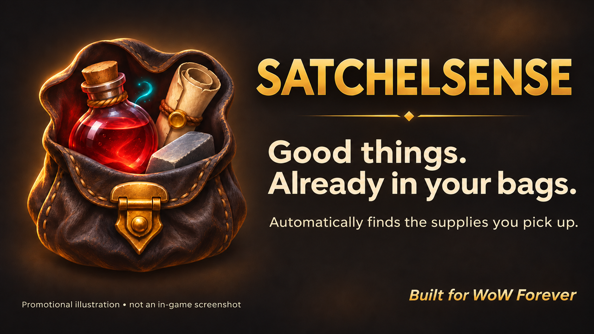

# SatchelSense

**Good things. Already in your bags.**

A standalone WoW Forever addon that gathers self-use consumables and item enhancements into a compact, clickable grid.

Previously released as PocketBuffs. Existing character settings and item keys import automatically, and older native grid-slot bindings continue to work. [GitHub project](https://github.com/dereknoll-jpg/SatchelSense).

## Features

- A 3×3 grid by default; 1×8, 8×1, 4×2 and custom layouts up to 8×8.
- Automatic discovery from carried bags, with counts merged across identical item IDs.
- Auto sorting is on by default: supplies group by type and fill gaps before another page is needed. Optional Manual mode preserves exact slots.
- New discoveries briefly glow gold. Ctrl-left-click the pouch to sort; right-click for quick controls and Compact only.
- Health and mana items first, then scrolls, buff food, enhancements, elixirs, flasks, bandages and other recognized self buffs. Favorites sort before these categories.
- Real item cooldowns from the client, including shared cooldowns reported by the game.
- Explicit numerical countdowns, independent of the game's optional cooldown-number setting. Bandages use the player's actual Recently Bandaged expiry, including duration reductions.
- Drag-sort item icons in the editor, use move arrows, or sort by type/name. Manual item order is saved per character.
- Unlock to drag directly between grid slots, with or without settings open. Shift-right-click the pouch to toggle the lock, then drag the unlocked pouch to move the grid.
- Empty buttons disappear completely. The grid has no background and does not intercept clicks in its empty areas.
- Dark charcoal settings, warm gold details, rounded icon masks and quiet numerals matching Paladin TankKit.
- Original pouch artwork in the addon list, settings header and optional tiny grid launcher.
- Per-character layout, position, filters, favorites, exclusions and explicit includes.
- Paging for more items than the chosen layout can fit. Every detected, enabled item remains accessible outside combat.
- Quick item keybinding from the editor, with keyboard modifiers, middle/side mouse buttons and mouse wheel support. Keys follow their item through sorting and page changes. Legacy slot bindings remain available in the game's Key Bindings menu.

## Install

Extract **both folders** from `dist/SatchelSense-1.0.4.zip` into `World of Warcraft/_forever_/Interface/AddOns`: `SatchelSense` is the addon and `PocketBuffs` is the bundled **SatchelSense - Settings Import** component. Replace the older files when prompted. Keep both enabled and restart WoW after the rename so it discovers the new folder. The manifest targets interface **16001**, matching the existing TankKit Forever project.

The import component keeps its old folder identity solely so WoW loads existing per-character saves. It has no HUD or item actions. SatchelSense copies an old profile only if a new profile does not already exist, then uses its own save. Original saved data and the game's normal keybinding profiles are not rewritten or deleted. `/satchel`, `/satchelsense` and `/ss` open settings; old `/pbuff` and `/pocketbuffs` shortcuts still work. See [the upgrade guide](release/UPGRADING.md).

Open settings with **`/satchel`**, right-click any item, or click the small pouch above the grid. Left-click an icon to use that item on yourself. For enhancements, click the icon and then select your weapon or other compatible item through the game's normal targeting cursor. Native restrictions and overwrite confirmations still apply.

Drag the settings window by its header or empty background to move it out of the way while editing the grid. It stays where you leave it when closed and reopened during the same session.

**Shift-right-click the pouch icon** to lock/unlock the grid without opening settings. While unlocked, drag the pouch to move the whole grid; wide layouts also show a `DRAG` tab. The handle is hidden on narrow layouts so it cannot cover the pouch. Turn off the pouch launcher if desired; `/satchel` remains available. When locked with no eligible items, the entire display disappears.

## Commands

| Command | Result |
| --- | --- |
| `/satchel` | Open settings |
| `/satchel unlock` / `lock` | Move or lock the grid |
| `/satchel layout 3x3` | Set columns × rows, each 1–8 |
| `/satchel layout 1x8` | Vertical strip |
| `/satchel layout 8x1` | Horizontal strip |
| `/satchel size 32` | Icon size, 20–56 pixels |
| `/satchel scale 1` | UI scale, 0.5–2 |
| `/satchel next` / `prev` | Change item page |
| `/satchel favorite 13444` | Toggle favorite priority for an item ID |
| `/satchel hide 13444` / `restore 13444` | Exclude or restore an item |
| `/satchel include 12345` | Explicitly include an unrecognized bag item as “Other self buffs” |
| `/satchel forget 12345` | Remove an explicit include |

Mouse wheel over an item or the page indicator changes pages. Clicking the page indicator advances and wraps back to page one.

Middle-click a grid item to hide it immediately, whether the grid is locked or unlocked (outside combat). Restore it under **Items & Keys**. Hiding an icon leaves its item keybinding assigned.

## Arrange items and bind keys

Open `/satchel` → **Items & Keys**. Rows follow the grid's reading order, across all grid pages; hidden/filtered items follow at the bottom. Drag an item icon onto another row, or use `<` / `>` beside an item to move it earlier/later. The arrows also move items across editor-page boundaries. Editor drags cannot consume an item. Choose **Auto** (default) or **Manual**. **By type** and **A - Z** sort now and choose the ongoing sort style in Auto; in Manual they perform a one-time sort. **Compact only** closes gaps while keeping the current item order. Favorites sort first in the automatic modes; explicit manual order takes precedence over favorites. Identical item IDs remain a single entry.

Unlock the grid to drag directly between slots, with or without settings open. An empty slot accepts the dragged item; dropping onto an occupied slot swaps the two items. Faint empty-slot outlines appear only while unlocked and disappear when locked. Dropping outside the grid cancels. Mouse-up events, a global release event and physical-button polling all finalize the drag so a missed drag-stop callback cannot leave its image stuck to the cursor. Drop targeting accounts for the grid's scale.

**Auto is on by default**, including on upgrade: new supplies are sorted into the existing grid, and used-up or hidden items leave no wasted spaces or unnecessary pages. Sorting pauses during combat and active drags. Dragging or using move arrows switches to **Manual**, which saves exact positions, reserves exhausted items’ slots, and appends new discoveries after the saved layout. Switching to Auto retains a copy of that manual layout; select Manual to restore it. Dragging between an editor row and a grid slot works too.

**Ctrl-left-click the pouch** for a one-time type sort and gap cleanup. **Right-click the pouch** for settings, Auto/Manual, Compact only, highlight and lock controls. Newly discovered items have an eight-second gold rim, with a short fade; off-page items highlight when first viewed. Existing inventory does not flash at login, and extra stacks do not retrigger the effect. Disable it under Layout or in the quick menu.

During editing, separate hit areas intercept grid mouse input so starting a drag cannot consume an item. **Lock the grid for normal click-to-use, even if settings remain open.** Blizzard's visibility driver hides the hit areas in combat; the underlying item buttons retain their normal actions throughout. Item keybindings continue to use their assigned items.

Click **Bind key** beside an item and press the desired key or modifier combination. Middle/side mouse buttons and wheel directions work too. Escape cancels; Backspace or Delete clears that item's binding. The editor asks before reusing an occupied key. These item bindings are saved per character and temporarily override the key's normal action while SatchelSense is active. Removing the binding restores the underlying action; the addon does not rewrite the game's binding profile.

A key binds the **item**, not the grid position. It still uses that item after reordering, changing pages, hiding its icon, or temporarily running out. A missing item simply cannot be used. Small labels on the grid show the key; item tooltips show its full name. The original first-nine-slot bindings remain supported for users who prefer position-based keys.

## Important behavior

**Combat:** Secure item buttons retain their item IDs and positions for the whole fight. Existing item counts and cooldown visuals can update; newly looted items, layout changes and page changes wait until combat ends. A depleted item stays in its original position with a zero until then. IDs prevent bag sorting from turning a button into a different item. Put emergency items on the first page or mark them as favorites before combat.

**Cooldowns:** The centered number counts down the client's reported item cooldown. For bandages, it shows the longer of the item cooldown and the player's readable Recently Bandaged debuff. No fixed one-minute timer is assumed. If that debuff is identifiable but its expiration is hidden, the icon dims and shows `?`; no duration is invented. Changing sort order and keys is restricted to outside combat, and entering combat cancels key capture.

**Food:** Plain food and water are off by default. Turn on “Plain food / drink” to include them. Buff-food detection uses current English tooltip wording and a small ID exception list. Numeric categories work across languages, but English name/tooltip fallback rules do not provide complete localization.

**Coverage:** This is an initial, offline-validated build, not a claim that every item in Forever has been live-tested. It discovers families from client metadata and readable tooltips rather than bundling a purportedly complete Classic item list. Unknown utility items, unusual buffs, hidden tooltip data, non-English food and future category changes may need an explicit include. Presence in a public item database does not prove current availability. Full research and the coverage boundaries are in [RESEARCH.md](RESEARCH.md).

**Use:** Every item use needs a player click or key press. The addon does not choose a “best” consumable, automatically consume loot, apply buffs in sequence, or infer which buffs stack. The game decides whether an item can be used at your level, in your location, or on your chosen equipment. High-level items are dimmed; other restrictions remain in the item's native tooltip/error message.

## Artwork and release files

- `Branding/SatchelSense-400.png`: CurseForge project avatar.
- `Branding/SatchelSense-1024.png`: Large square promotional artwork.
- `Branding/SatchelSense-master.png`: Original generated master.
- `SatchelSense/Media/AddonIcon.tga`: 64×64 in-game addon/launcher icon.
- `SatchelSense/Media/PouchArt.tga`: 256×256 settings artwork.
- `release/DESCRIPTION.md`: Listing draft.
- `release/LIVE-CHECKS.md`: Short in-client verification pass.

## Development

Run `npm install` once, then `npm test`. `scripts/Build.ps1` runs validation, exports artwork, and creates the installable ZIP. Node dependencies are development-only; the game requires none of them. The initial local validation reused the same installed Lua tooling as the neighboring addons.

`scripts/Package-Release.ps1` builds the addon and assembles the self-contained CurseForge kit under `release/curseforge`, plus a single downloadable kit ZIP in `dist`. Upload only the inner addon ZIP as a CurseForge file; the larger kit also includes images and copy-ready text for the project page. See `release/RELEASE-READINESS.md` before labeling 1.0 stable.

The offline suite executes all addon Lua against a small game API model and checks filtering, duplicate stacks, all configured layout bounds, pagination, favorites, exclusions, includes, delayed item/tooltip data, protected combat mutations, and restricted values. Actual input handling, artwork rendering and native item-targeting behavior still need the in-client pass.

## Publishing

Versioned releases use annotated Git tags and matching TOC versions. The active CurseForge webhook packages tag pushes with `.pkgmeta`; current release notes come from `SatchelSense/RELEASE-NOTES.md`. See [publishing steps](release/PUBLISHING.md).
